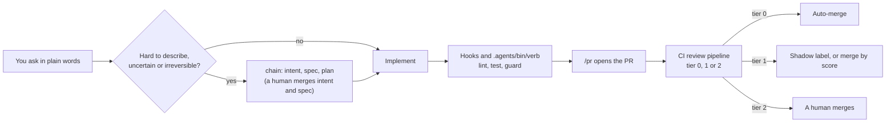

# agentive

[](LICENSE)

> An AI-native SDLC and codebase framework that keeps AI agents oriented in your codebase so they consistently deliver output.

agentive is a plugin for **Claude Code** and **Codex**. One command adds a small layer of instructions, hooks, skills and
CI to your repository, so every agent session starts from the same commands, the same guard rails and the same review
rules. Which tool implements and which tool reviews is your choice; agentive assigns no roles to tools.

Status: version 0.1.0, an early release.

## Quick start

You need a GitHub repository, `git`, `python3` 3.13 or newer, and Claude Code >= 2.1.296 (or Codex).

```sh
claude plugin marketplace add xrpz/agentive
claude plugin install agentive@agentive --scope project
```

Then, inside a Claude Code session:

```text
/reload-plugins
/agentive:init
```

init reads your code, lockfiles, package files, CI config and README, writes the files listed
[below](#what-you-get), and prints the changed files, what is now on, and a one-line revert. It does not commit.
Prefer one command? `claude plugin install agentive --marketplace xrpz/agentive` works on Claude Code 2.1.292 or newer.
With project scope, each collaborator runs the install once.

**Codex:** run `codex plugin marketplace add xrpz/agentive`, install the plugin from the Codex plugin browser, trust
the agentive hooks in `/hooks` (both are human steps), then run `$agentive-init`.
A Codex-only bootstrap is described in [AGENTS.md](AGENTS.md).

**Let your agent do it:** tell it `install https://github.com/xrpz/agentive`. It follows the
[install sequence](AGENTS.md#install-agentive-into-a-project-agent-led-install).

## Before and with agentive

| Without a repo layer | With agentive |
|---|---|
| The agent guesses how to build and test. | Every verb (`setup`, `build`, `lint`, `typecheck`, `test`, `verify`, `run`) runs through `.agents/bin/verb`, filled in from evidence in your repo. A verb without evidence stays `pending (no evidence)`. |
| A failing command floods the context. | The full log stays on disk, a short excerpt is printed, and the last line says what to do next (`NEXT=`). |
| Rules live in reminders the agent can forget. | Hooks lint edited files, run `verify` before a session may stop, and deny risky commands (push to the default branch, force push, tag push, publish). |
| A big change goes straight into code. | `intent -> spec -> plan`, each stage reviewed by a human before code is written. |
| Review comments are walls of text. | Each PR comment opens with the verdict and one "What to do" sentence; details are folded. |

## How it works

1. **Install the plugin** and run `/agentive:init` once. It writes the repo layer and proves each verb on your repo.
2. **Work as usual.** Hooks and `.agents/bin/verb` run while the agent works; large or risky changes go through the chain.
3. **Open a PR with `/pr`.** CI reviews it and sorts it into tier 0, 1 or 2; the tier decides who merges.



## What you get

| Path | What it is |
|---|---|
| `AGENTS.md`, `CLAUDE.md` | Managed regions with the verb commands, test locations and pointers to docs that exist. Your own lines stay. |
| `code_review.md` | Machine rules of the CI review gate (trust boundary, confirm scope, tiers). What a reviewer checks is the `## Code Review Rules` section of `AGENTS.md`. `REVIEW.md` is written only if you opt in during init. |
| `.agents/bin/` | `verb`, `agentive-lint`, `agentive-review`, `agentive-reviewer-eval`. |
| `.agents/hooks/`, `.agents/guard.yaml` | Hook scripts and the deny/ask command rules. |
| `.agents/skills/` | Repo skills: `chain-intent`, `chain-spec`, `chain-plan`, `verify`, `precommit-review`, `pr`, `pr-feedback`, `distill`, `janitor`. |
| `.agents/agents/` | Reviewers (correctness, security, testing), verifier, classifier. |
| `.agents/manifest.yaml`, `rubric.yaml` | What init found and proved; the risk-score rubric. |
| `.claude/settings.json`, `.codex/` | Hook wiring and permissions, merged by key; your own entries stay. |
| `.github/workflows/`, `.github/pull_request_template.md` | `agentive-review`, `agentive-lint`, `reviewer-eval`; the PR body headings. |

Settings you want to change go in `.agents/framework.yaml` (overrides only). Customizations of generated files go in
`.agents/custom/`, so updates keep them.

## See it work

A failed verb ends with one line to act on (default form; `<ts>` is a timestamp):

```text
AGENTIVE_FAIL verb=test exit=1 log=.agents/state/logs/test-<ts>.log; NEXT=grep -n -m20 -E '(error|Error|ERROR|fail|FAIL|Fail)' .agents/state/logs/test-<ts>.log
```

A PR comment opens with the verdict (this one is for a change under an auth path):

```markdown
### ⚠️ agentive review: needs a human review — security-sensitive change

**What to do:** Check the sensitive files listed in Details and the AI findings, then merge by hand.
Auto-merge never applies to this PR.
```

## Daily workflow

1. Say what you want in plain words. A change that is hard to describe in one sentence, touches two or more modules,
   is uncertain, or is hard to reverse goes through `/chain-intent`, `/chain-spec` and `/chain-plan <slug>`.
   A small change is implemented directly.
2. Follow the `NEXT=` of any failed line while the agent works.
3. `/verify`, then `/precommit-review`, then commit.
4. `/pr` opens the PR with a fixed body (`## Explainer` on tier 2, `## Verification`, `## Risk`, `## How to revert`).
5. CI reviews the PR; `/pr-feedback` fixes confirmed findings and failing checks in one pass.

Runs with no human present (headless runs with `claude -p`, Routines runs) write the same files and ask nothing.

Before you change machine in the middle of a chain task, tick the finished checkboxes of `docs/plans/<slug>/plan.md`, commit and push the branch. The conversation does not move to the other machine; a new session on that branch is shown the open checkboxes (`OPEN_WORK=`).

## Review and auto-merge

CI runs deterministic checks, specialist reviewers in separate contexts, a verifier for each finding, and a gate
(`agentive-review-gate`) that sorts every PR into a tier.

| Tier | Which PRs | What happens (default `review.auto_merge: low_risk`) |
|---|---|---|
| 0 | Only docs or whitespace changes, up to 200 changed lines, no trust-boundary path | Merged automatically when every gate passes. |
| 1 | Everything else that is not tier 2; scored by the rubric (above 28 goes to a human) | Shadow mode: a PR the gate would have merged gets the label `agentive:shadow-auto-merge`; a human merges it. |
| 2 | Auth, security, permissions, secrets, migrations, CI config, hooks and settings, billing paths; dependency changes; over 1,000 changed lines; chain intent and spec PRs | Always a human. |

`review.auto_merge` accepts `off`, `dry_run`, `low_risk` (default) and `low_and_medium_risk`. Merging needs "Allow
auto-merge" in the GitHub repository settings, and branch protection that requires `agentive-review-gate` is
recommended. If two merged PRs of the same tier and source are reverted or hotfixed within 7 days, auto-merge stops for
that scope until a human closes the issue labelled `agentive:auto-merge-demoted`.

The CI review uses the tool that ran init (`claude` or `codex`); override it with `review.pipeline.ci_tool`. Add the
matching repository secret: `ANTHROPIC_API_KEY` or `CLAUDE_CODE_OAUTH_TOKEN`, or `OPENAI_API_KEY`.

## Update

```sh
claude plugin update agentive@agentive      # Codex: codex plugin marketplace upgrade agentive
```

Then `/reload-plugins` (or restart) and run `/agentive:update` (Codex: `$agentive-update`). It re-applies the current
templates, keeps files you changed and reports them; `--status` only reports, `--force` overwrites. After a package
file or lockfile changes, `/agentive:reprove` re-proves the affected verbs.

## FAQ

**Does it change my code?** No. init never edits your source, tests, package files or lockfiles. It adds the files
above, edits the managed regions of `AGENTS.md` and `CLAUDE.md` and of `.gitignore`, and merges its keys into
`.claude/settings.json`. While proving a verb it writes a temporary seed file, runs the verb once and deletes the seed.

**Does it commit?** No. init and update only write files. You commit, or the agent does through `/verify` and
`/precommit-review`. If you open a PR for the install, a human reviews and merges it first; it gets no AI review.

**Which tools does it support?** Claude Code and Codex. Either can implement; the CI reviewer is the one that ran init.

**How do I undo it?** There is no uninstall command. Before you commit, run the `git checkout -- ...` and
`git clean -fd -- ...` lines that init printed as `AGENTIVE_REVERT`. After you commit, revert the commit like any other.
To remove the plugin itself: `claude plugin uninstall agentive@agentive --scope project`. This does not delete files
already written into your repository.

**What about private repos and secrets?** The scripts agentive installs make no network calls at run time, except
`gh api` in the PR skills and the janitor gate. The CI review sends the PR to Claude or Codex with the repository secret
you add yourself. Changes to paths such as `.env*` or `*secret*` are always tier 2, merged by a human.

## Troubleshooting

| You see | Do this |
|---|---|
| `/agentive:init` is not offered | `claude plugin list` must show `agentive@agentive`; run `/reload-plugins`. |
| `AGENTIVE_STOP` from init | The repo is already initialized; run `/agentive:update`. |
| `AGENTIVE_HOOKS ... status=off` | A hook failed its smoke check, so `.claude/settings.json` was not written and the guard rules are not enforced. Follow its `NEXT`. |
| A verb says `pending (no evidence)` | init never picks a stack. Add the command to your project, then run `/agentive:update`. |
| `NEXT=install python3 >= 3.13` | Install `python3` 3.13 or newer. |
| `AGENTIVE_DRIFT` | Your existing files were kept; proposed diffs are in `.agents/state/conflicts/`. |
| PR says "AI review failed" | Open the failed `ai-review` job; the usual cause is a missing repository secret (above). |
| A tier 0 PR does not merge | Turn on "Allow auto-merge" in the repository settings, then read the gate summary comment for the reason. |

## For contributors

This repo holds the design and the generator that builds both plugins; the files under `plugins/` and `docs/map/` are
generated. Read [AGENTS.md](AGENTS.md) (editing rules) before changing anything, then the sections of
[docs/IMPLEMENTATION.md](docs/IMPLEMENTATION.md) (architecture) that your change touches. The design is
[design/framework.yaml](design/framework.yaml), rendered at [docs/map/index.html](docs/map/index.html), with a decision index in
[docs/DECISIONS.md](docs/DECISIONS.md) and a line index in [design/INDEX.md](design/INDEX.md).

```sh
python3 tools/generate.py && python3 tools/generate.py --check
python3 tools/selftest.py --fast    # before a commit
python3 tools/selftest.py           # before a PR and for a release (what CI runs)
```

## License

MIT. See [LICENSE](LICENSE).
